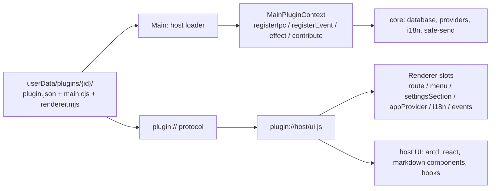
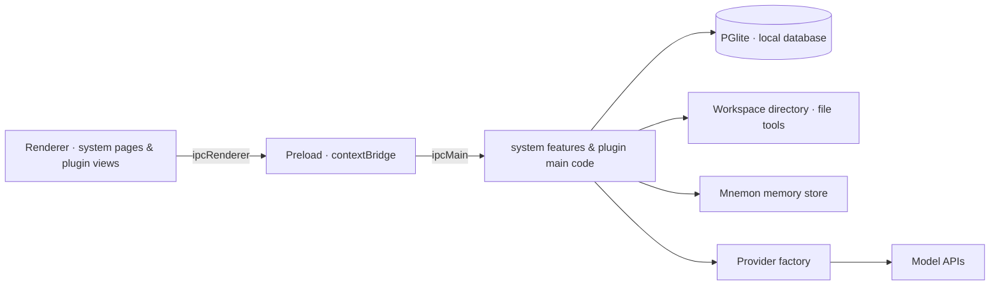

<p align="center">
  
</p>

<h1 align="center">RytenBench</h1>

<p align="center">An AI-powered personal desktop workspace — documents, knowledge bases, todos, knowledge graphs and an agent workbench, in one Electron app.</p>

<p align="center">
  
  
  
  
  
  
</p>

---

## Overview

RytenBench is a cross-platform Electron desktop application that puts two things side by side:

- a **notes workspace** — Markdown documents, knowledge bases with a directory tree, todos, and an
  LLM-built knowledge graph;
- an **AI assistant workbench** — multiple workspaces, per-workspace conversations driven by a
  LangGraph runtime with streaming, tool calling, sub-agents, background jobs, OS-level sandboxed
  command execution and a three-layer memory system.

The two flagship views — **Notes** and the **AI assistant** — are **system features**, not plugins:
their code is part of the main and renderer trees themselves (`src/main/**`, `src/renderer/src/**`)
and is compiled into the application. They never enter the plugin registry and have no install,
enable or uninstall step; their IPC channels are the ordinary `harness:*` / `notes:*` namespaces,
registered by `src/main/system/` at startup and reached through `window.api.system`. The core
process owns the window / tray / theme / i18n shell, the system-feature wiring, the PGlite database
engine, the model provider factory and the generic preload bridge. Everything else is a **plugin** —
third-party extensions loaded from on-disk packages (`userData/plugins/<id>/`) through the plugin
host, which can be enabled, disabled or uninstalled at any time.

---

## Features

### Notes — system feature

- **Dashboard** — a landing view with a time-aware greeting, recent documents, open todos and
  overdue counts, plus quick entry points into the document tree.
- **Document tree** — hierarchical documents and directories with in-tree search across documents,
  todos and knowledge bases; create, import, delete and archive documents.
- **WYSIWYG Markdown editor** — built on TipTap v3 with bidirectional Markdown conversion:
  a slash (`/`) block menu, tables, task lists, code blocks with syntax highlighting, KaTeX math
  and Mermaid diagrams with pan/zoom controls. MDX constructs (`import` / `export` / JSX) survive
  both editing and preview untouched. Pasted and dropped images are compressed on the fly
  (screenshots stay PNG, other formats become JPEG q0.85, GIF is passed through). Debounced
  auto-save plus `Ctrl+S`, a save-state indicator, a breadcrumb bar and an outline panel that
  scrolls in sync with the document.
- **Documents** — title, summary, tags and per-document properties; import from `txt` / `md` /
  `docx` / `html` (DOCX via mammoth, HTML article extraction via Readability, both converted to
  Markdown), export back to Markdown.
- **Knowledge bases** — wikis with a nested directory tree, summaries, tags and cover images.
  Documents are linked into directories through a many-to-many model, so one document can live in
  several knowledge bases; an archive dialog moves a document straight into a chosen directory.
- **Todos** — priority, status, category and Markdown body, with a dependency graph between tasks.
  The notes view has a dedicated todo pane next to the outline panel.
- **Knowledge graph** — extracted from the documents of a knowledge base by the configured model:
  heading-aware chunking, entity and relation extraction with cached LLM calls, cross-chunk entity
  merging, an optional gleaning second pass, and incremental appends when new documents are added.
  Rendered on an ECharts canvas with an entity detail panel and persisted node positions; build
  progress streams into a floating progress overlay. Build parameters (concurrency, chunk size,
  gleaning threshold) and the graph / embedding models are configured in Settings → Graph.

### AI assistant — system feature

- **Workspaces** — each workspace is bound to a real directory on disk. Conversations (topics),
  messages, sub-agent configuration and memory are isolated per workspace; switching workspaces
  never leaks history or memory between them.
- **Streaming conversation** — token streaming with a typewriter renderer, reasoning (thinking)
  display, tool-call cards with an on-demand detail viewer, and a per-turn usage panel (provider /
  model, cached vs. uncached input, cache reads and writes, output, reasoning share, call count).
- **Input & attachments** — file reference chips, drag-and-drop or pasted images (with a vision
  capability check against the selected model) and a message queue: sending while a turn is
  running parks the message in a dock where it can be edited, removed or injected into the running
  turn immediately.
- **Goals** — a long-running objective can be persisted on the topic; the goal bar shows phase
  (active / paused / blocked / complete) and round progress, and automatic continuations are
  rendered as their own rounds in the transcript.
- **Sub-agents & background agents** — named agents with their own system prompt, tool selection
  and memory directory; the main agent can delegate through a task tool, and background agents run
  in parallel with a status button summarising running / completed / failed / stopped runs.
- **Workflow orchestration** — a workflow tool lets the model write a JavaScript orchestration
  script (top-level `await`, `agent` / `pipeline` / `parallel` / `phase` / `log` / `args` hooks)
  that fans work out across many one-shot sub-agents, executed in a `node:vm` sandbox with no
  filesystem, network or timers, and with concurrency and total-agent caps.
- **Context compaction** — history is kept inside the model window by two mechanisms: a
  zero-cost tool-result pruner applied when history is replayed, and LLM summarisation that folds
  the oldest exchanges into a structured checkpoint persisted per topic and reused until the
  compaction boundary advances again.
- **Memory (Mnemon)** — a three-layer memory system in every workspace: runtime memory (a user
  profile plus a project memory file, injected every turn), project documents (Markdown archives
  with hot/cold tiering) and long-term memory spaces (graph relations with deep recall, backed by
  PGlite). It is exposed to the model as 13 `mnemon_*` tools and is configurable in
  Settings → Memory.
- **Skills** — a local directory of skills, where every sub-directory containing a `SKILL.md`
  (YAML frontmatter with `name` / `description`) is a skill; enabled skills are injected into the
  system prompt. Managed in Settings → Skills.
- **MCP servers** — connect Model Context Protocol servers over stdio (a local command such as
  `npx` / `uvx`, with arguments, working directory and extra environment variables) or over
  Streamable HTTP / SSE (URL plus request headers), and their tools join the same tool-call loop as
  the built-in and plugin tools. Managed in Settings → MCP.
- **Workspace files** — file explorer and CodeMirror 6 editor (with a Markdown rich/source toggle,
  language modes, search, folding, word wrap and caret/selection status) inside the assistant view,
  live-reacting to on-disk changes and warning when a file changed on disk while unsaved edits
  exist.
- **Change review** — every write the agent performs is recorded: before-image snapshots on disk
  plus per-file change history. The diff view supports per-hunk Keep / Revert, Keep all and
  Revert all, and older revisions can be inspected without losing the pending review.
- **Sandboxed commands & permission modes** — every session runs under one of three modes —
  **Read only** (`read-only`), **Workspace write** (`workspace-write`, the default) and
  **Full access** (`danger-full-access`) — and the `execute` tool wraps shell commands in an
  OS-level sandbox:
  a restricted token with capability SIDs on Windows, a self-built Landlock launcher (or `bwrap`
  when it is installed) on Linux, and the system `sandbox-exec` on macOS. A write outside the
  workspace is refused by the kernel and comes back to the model as a `[sandbox: …]` marker; when
  no backend is available the command is **not** run, with no unsandboxed fallback. Risky commands
  are shown for approval first, and a denied call can be retried once through the narrowly wider
  mode with an explicit prompt. Backend status and workspace-ACE cleanup live in
  Settings → Agents → Sandbox.
- **Failure recovery** — when a model request fails, a recovery dialog lets you switch to another
  configured model and resume from the interruption point: the prompt is not resent and completed
  tool calls are not re-run.

### Model providers

- Multiple providers and models with **AES-256-GCM encrypted API keys**, encrypted with a
  machine-specific key — credentials are bound to the machine that created them.
- Protocol-based configuration: pick a known platform or type any protocol identifier, and any
  unknown protocol is called in an OpenAI-compatible way. Custom endpoints can be OpenAI- or
  Anthropic-compatible.
- **Model profile autofill** — model IDs are matched against a bundled `models-profile.json`
  while typing, filling in the official display name, context window, max output and capability
  flags; anything unlisted can be filled in by hand.
- Fetch a model list from any OpenAI-compatible endpoint (`GET /v1/models`) and add models in
  batches, set a default chat model (and a separate default embedding model), pin favourites,
  and tune sampling parameters (temperature / top-p / top-k), thinking mode, image input support,
  context window, max output and per-conversation tool-call rounds.

### Application shell

- **Native window chrome** — on Windows the window is a plain system window: the native title bar
  carries the app icon, the name RytenBench and the system minimize / maximize / close buttons, and
  the app's light / dark choice is pushed to the system title bar and the DWM window border so the
  frame never keeps the wrong colour. macOS keeps `titleBarStyle: hiddenInset` with the traffic
  lights plus a slim self-drawn App / Edit menu strip; Linux uses the native frame.
- **Shell** — a themed sidebar (brand and version, Library / Plugin repository navigation, the
  assistant's conversation sidebar with its mode switcher, workspace tree and memory, and the user
  area with the notification popover, Settings and a light / dark toggle) next to the content area.
  The old frameless shell — bottom bar, right bar, plugin-registered navigation — is gone; plugin
  routes still render in the content area but no longer own the chrome.
- **System pages** — the assistant (`/harness`, the default route), Library (`/notes`) and Plugin
  repository (`/plugins`, with a per-plugin detail page at `/plugins/:pluginId`), with the shared
  assistant sidebar always available on the left.
- **Weather** — local conditions and a three-day forecast from Open-Meteo, located through IP
  geolocation and cached by the main process (exposed through `window.api.weather`).
- **Settings** — a two-group modal. **General**: General (interface language, theme, tray
  behaviour, lock screen), Models, Graph and System. **Assistant**: Agents, Skills, Memory and MCP.
  Plugin management, the plugin workshop and third-party plugin settings pages are dialogs inside
  Plugin repository; Settings itself only holds the app's own configuration.
- **Localization** — Simplified Chinese and English, switchable at runtime without restart, and
  the main process renders tool output and progress text in the current language too.
- **Theme** — light / dark / auto, where auto follows the time of day (light from 6:00 to 18:00).
- **Lock screen** — an optional 6-digit passcode lock with a change-passcode flow.
- **System tray** — closing the window can keep the app resident in the tray (restore or quit from
  the tray menu); single-instance behaviour focuses the existing window instead of starting a
  second copy.
- **Startup & failure handling** — the main window is created and shown immediately, covered by an
  in-app startup splash (mascot, current task, progress) fed over IPC while the main process
  initialises the database, migrations, workspace and plugin host in the background; the splash
  reports a failed initialisation instead of leaving a blank window, and fades into the interface
  once the first frame is ready. Around that: a renderer error boundary that offers a reload,
  renderer-crash recovery that rebuilds the main window, crash dumps collected locally
  (`userData/Crashpad/reports`, never uploaded), and a database recovery path that can back up and
  restart from an empty database if PGlite fails to open.

---

## Plugins

Plugins are third-party extensions. They are not bundled with the app, they are loaded from
on-disk packages (`userData/plugins/<id>/`) through the plugin host, and they can be enabled,
disabled or uninstalled at any time.

The two flagship views are **not** plugins: Notes and the AI assistant are system features compiled
into the application (see [Features](#features)), so they never appear in the registry below.

| Plugin         | What it provides                                                      |
| -------------- | --------------------------------------------------------------------- |
| `task-planner` | Planner with a Gantt chart and hierarchical task tree                 |
| `music-player` | Folder playlists, playback controls, mini player, metadata extraction |

Both are published in the companion repository
[`Aitenry/ryten-plugins`](https://github.com/Aitenry/ryten-plugins) and installed from the in-app
plugin repository page (route `/plugins`). A fresh install therefore has an empty plugin registry
until the user adds one.

### Installing plugins

1. **Plugin repository** — a GitHub-hosted index (`plugins.json`) lists plugin ids with their
   version, size and `sha256`. The app downloads the matching Release asset, verifies the checksum,
   unpacks it (rejecting path traversal) and validates `plugin.json` before installing or
   upgrading. The repository URL can be overridden with `RB_PLUGINS_REPO`.
2. **Local install** — install from a local `.zip` package or an unpacked plugin folder.

A plugin can be **enabled / disabled** at any time: disabling it unloads its routes, menu entries,
settings pages, providers, IPC channels, event channels, i18n resources and AI tools immediately.
**Uninstalling removes its code**; deleting its data is a separate, opt-in checkbox in the confirm
dialog (each plugin declares what that would remove, and nothing is deleted by default — data is
still there after reinstalling).

### Plugin package layout

Third-party plugins use the shape below; the host-side loader, installer and bundler in this
repository (`src/main/plugins/`, `scripts/build-plugins.mjs`) work with any directory following it:

```
<id>/
  plugin.json            id / name / version / description / icon / entry files
  main.cjs               bundled main-process entry (install(ctx))
  renderer.mjs           bundled renderer entry (default { manifest, install(ctx) })
  chunk-*.mjs            lazy chunks
  plugin.css             optional styles, injected by the plugin host
```

Source layout before bundling, as used by the companion repositories:

```
<id>/
  manifest.ts            id / name / version / description / icon / inject / routes / menu
  main/
    index.ts             export function install(ctx: MainPluginContext)
    ipc/                 this plugin's IPC channels (ctx.registerIpc)
    db/schema.ts         this plugin's Drizzle tables
    db/mapper.ts         row types and queries (through withOrm)
    services/**.ts       business services
  renderer/
    plugin.tsx           export default { manifest, install(ctx) }
    api.ts               thin wrapper over window.api.plugin.invoke/on
    Index.tsx            route page (lazy-loadable)
    components/ hooks/ utils/
  shared/**.ts           main/renderer DTOs
  locales/index.ts       zh-CN / en-US copy, registered with the plugin
```

`pnpm build:plugins` bundles each configured plugin into a loadable disk package —
`resources/plugins/<id>/{plugin.json,main.cjs,renderer.mjs,chunk-*.mjs}` — which is what ships as an
`extraResources` entry and what the host actually loads. The id list lives in
`scripts/build-plugins.mjs`; this application currently ships no bundled plugins, so the list is
empty.

### Host contract

Plugin packages never bundle their own copy of the database, React or i18n. At build time imports
pointing into the core or the host UI are rewritten to `@host/**` specifiers, and at runtime the
host injects the single instances it already has:

- **Main process** — `globalThis.__RB_HOST_RESOLVE__` resolves 21 host module entries
  (`@host/main/**`, plus shared model-parameter presets); other bare modules (electron,
  langchain, zod, drizzle, …) resolve to the host's own instances from the application root.
- **Renderer** — an ESM bridge served from `plugin://host/ui.js?m=<key>` exposes 15 host UI
  modules (i18n, hooks, Markdown components, settings UI, routing skeletons, utilities) plus 8
  vendored libraries (react, react-dom, antd, @remixicon/react, @ant-design/icons, dayjs) so
  provider contexts and component instances stay shared.

Main-process context API: `registerIpc`, `registerEvent`, `effect` (LIFO rollback), `contribute`
and `provide`. Renderer slots: `route`, `menu`, `settingsSection`, `appProvider`,
`globalComponent`, `api`, `i18n`, `events`, `storage` — plugin settings sections and the workshop
render as dialogs inside Plugin repository, and the shell slots of the old frameless UI (title bar,
bottom bar, right bar) are no longer rendered. Contribution points let plugins extend each other
without importing each other, and the same contract is reused by the system features: the assistant
pulls AI tools from `harness.tool` contributions (this is how the notes system feature exposes its
document, wiki, todo and graph tools to the model), and `plugin.purge` lets a feature or plugin
clean up its own data on uninstall.

Channel naming is namespaced as `plugin:<id>:<channel>`; the host validates ownership, rejects
duplicates, and pushes the authoritative channel list to the preload whitelist whenever plugins
are loaded or unloaded.

More detail lives in [`src/plugins/README.md`](src/plugins/README.md),
[`src/plugins/PACKAGING.md`](src/plugins/PACKAGING.md) and
[`src/plugins/MIGRATION.md`](src/plugins/MIGRATION.md).

---

## Tech stack

| Layer            | Technology                                                                                                                                                                   |
| ---------------- | ---------------------------------------------------------------------------------------------------------------------------------------------------------------------------- |
| Framework        | [Electron](https://www.electronjs.org/) 44                                                                                                                                   |
| UI               | [React](https://react.dev/) 19 + [TypeScript](https://www.typescriptlang.org/) 5.9                                                                                           |
| Build            | [electron-vite](https://electron-vite.org/) 6 + [Vite](https://vite.dev/) 8                                                                                                  |
| Component system | [Ant Design](https://ant.design/) 6 + [Tailwind CSS](https://tailwindcss.com/) 4                                                                                             |
| Routing          | [React Router](https://reactrouter.com/) 7 (hash routing)                                                                                                                    |
| i18n             | [i18next](https://www.i18next.com/) 26 + react-i18next                                                                                                                       |
| Markdown editor  | [TipTap](https://tiptap.dev/) 3 + [tiptap-markdown](https://github.com/ueberdosis/tiptap-markdown)                                                                           |
| Markdown view    | [react-markdown](https://github.com/remarkjs/react-markdown) + remark-gfm + rehype-katex/highlight                                                                           |
| Diagrams & math  | [Mermaid](https://mermaid.js.org/) 11 + [KaTeX](https://katex.org/) + [highlight.js](https://highlightjs.org/)                                                               |
| Code editor      | [CodeMirror 6](https://codemirror.net/) via [@uiw/react-codemirror](https://github.com/uiwjs/react-codemirror) + [@codemirror/merge](https://codemirror.net/docs/ref/#merge) |
| Agent runtime    | [LangChain](https://www.langchain.com/) 1.5 + [LangGraph](https://langchain-ai.github.io/langgraph/) 1.4                                                                     |
| Database         | [PGlite](https://pglite.dev/) 0.5 (PostgreSQL compiled to WebAssembly) + [Drizzle ORM](https://orm.drizzle.team/) 0.45                                                       |
| Settings store   | [electron-store](https://github.com/sindresorhus/electron-store) 11                                                                                                          |
| Graph rendering  | [ECharts](https://echarts.apache.org/) 6                                                                                                                                     |
| Validation       | [zod](https://zod.dev/) 4                                                                                                                                                    |
| Document import  | [mammoth](https://github.com/mwilliamson/mammoth.js) + [turndown](https://github.com/mixmark-io/turndown) + [Readability](https://github.com/mozilla/readability)            |
| Audio metadata   | [music-metadata](https://github.com/Borewit/music-metadata) (music plugin)                                                                                                   |
| Weather          | [open-meteo](https://open-meteo.com/)                                                                                                                                        |
| Icons            | [Remix Icon](https://remixicon.com/) + Ant Design Icons                                                                                                                      |
| Logging          | [electron-log](https://github.com/megahertz/electron-log)                                                                                                                    |
| Packaging        | [electron-builder](https://www.electron.build/) 26                                                                                                                           |
| Sandbox          | Self-built, no third-party dependency: Windows restricted token + capability SIDs, Linux Landlock or `bwrap`, macOS `sandbox-exec`                                            |

---

## Model protocols

| Protocol                      | Notes                                           |
| ----------------------------- | ----------------------------------------------- |
| OpenAI                        | Also the fallback for any OpenAI-compatible API |
| Anthropic                     | Claude models                                   |
| DeepSeek                      | Includes reasoning support                      |
| Google Gemini                 | Generative Language API                         |
| Google Vertex AI              | Google Cloud deployments                        |
| Mistral AI                    | Mistral models                                  |
| Ollama                        | Local models                                    |
| OpenRouter                    | Multi-model gateway                             |
| xAI                           | Grok models                                     |
| AWS Bedrock                   | Converse API                                    |
| Cloudflare Workers AI         | Edge-hosted models                              |
| Custom (OpenAI-compatible)    | Any `/v1/chat/completions`-shaped endpoint      |
| Custom (Anthropic-compatible) | Any Anthropic-shaped endpoint                   |

The model form also offers platform presets for common Chinese providers (Zhipu GLM, Alibaba
Cloud Bailian, Baidu Qianfan, Volcano Engine Ark, Tencent Hunyuan, SiliconFlow), which are
configured as OpenAI-compatible endpoints. A separate default embedding model is used for
knowledge base embeddings.

---

## Getting started

### Prerequisites

- [Node.js](https://nodejs.org/) ≥ 20.19 (or ≥ 22.12; Node 22 LTS recommended)
- [pnpm](https://pnpm.io/) ≥ 9 (CI builds with pnpm 10)

`.npmrc` points the Electron and electron-builder binary downloads at the npmmirror mirrors, which
helps on networks where the default hosts are slow. `postinstall` installs the Electron binary and
rebuilds native dependencies.

### Install and run

```bash
git clone https://github.com/Aitenry/RytenBench.git
cd RytenBench
pnpm install
pnpm dev
```

### Scripts

| Command              | What it does                                                                         |
| -------------------- | ------------------------------------------------------------------------------------ |
| `pnpm dev`           | Build the sandbox assets, then start the app with hot reload                         |
| `pnpm build:sandbox` | Build the sandbox assets into `resources/sandbox/`                                   |
| `pnpm build:plugins` | Bundle every plugin listed in `scripts/build-plugins.mjs` into `resources/plugins/`  |
| `pnpm build`         | Type-check and build the main, preload and renderer bundles                          |
| `pnpm typecheck`     | `tsc --noEmit` for the node and web projects                                         |
| `pnpm lint`          | ESLint over the repository (it also walks build output, so it is slow)               |
| `pnpm build:win`     | Sandbox assets + plugin packages + app bundles + Windows NSIS installer              |
| `pnpm build:mac`     | Sandbox assets + plugin packages + app bundles + macOS DMG and ZIP (not notarized)   |
| `pnpm build:linux`   | Sandbox assets + plugin packages + app bundles + Linux AppImage and DEB              |
| `pnpm build:unpack`  | Unpacked directory build, useful for quick smoke tests                               |

A faster local lint that skips `dist/` and `node_modules/`:

```bash
npx eslint --cache src examples electron.vite.config.ts
```

> Plugin packages and sandbox assets are generated artifacts: `resources/plugins/` and
> `resources/sandbox/` are not committed, and packaging scripts run `build:plugins` and
> `build:sandbox` first. This app currently bundles no plugins, so the list in
> `scripts/build-plugins.mjs` is empty; a plugin added to that list is built from
> `src/plugins/<id>/` and shipped as an `extraResources` entry. The sandbox sources live in
> `native/`, and CI runs its `--selfcheck` against the packaged app, so a build only ships when the
> sandbox inside the installer really enforces the write boundary.

## Releases

Every push to `main` publishes a real version — there is no alpha channel and nobody edits the
version by hand. `.github/scripts/resolve-version.mjs` derives it from the last stable tag and the
commit messages:

| Change since the last release  | Next version                    |
| ------------------------------ | ------------------------------- |
| `fix(...)`, `chore(...)`, …    | patch — `0.1.0` → `0.1.1`       |
| `feat(...)`                    | minor — `0.1.1` → `0.2.0`       |
| `BREAKING CHANGE:` / `feat!:`  | major — `0.2.x` → `1.0.0`       |

`[release:major|minor|patch]` in a commit message overrides the inference, and the first release
takes the version already in `package.json`. Development happens on a branch named after the version
(`0.1.0`, `0.2.0`, …), so release tags carry a `v` prefix (`v0.1.0`, `v0.1.1`): when a branch and a
tag share a name, git resolves the bare name to the tag, so `git merge 0.2.0` would silently merge
nothing. The build stamps the resolved version in before packaging, so installer file names and
`app.getVersion()` report it, and a release is published only when every platform artifact is
present and the sandbox inside the packaged app has passed its self-check. After a successful
publish the version is committed back to `main` as `chore(release): <version> [skip ci]`, which
never counts as a change; rerunning a workflow for an already published commit is a no-op.

---

## Project structure

```
RytenBench/
├── src/
│   ├── main/                         # Electron main process
│   │   ├── index.ts                  # Single instance, protocol, startup, windows, tray, host init
│   │   ├── lifecycle.ts  context.ts  safe-send.ts
│   │   ├── weather.ts                # Open-Meteo + IP geolocation, cached and pushed
│   │   ├── address/  crypto/  resource/  tray/  windows/
│   │   ├── database/                 # PGlite + Drizzle engine
│   │   │   ├── loading.ts  instance.ts  orm.ts
│   │   │   ├── schema/               # Core tables (+ harness/ and notes/ tables)
│   │   │   ├── mapper/               # Core row types (+ harness/ and notes/ queries)
│   │   │   ├── workspace-context.ts  # Active workspace for tools and IPC
│   │   │   └── workspace-migration.ts
│   │   ├── i18n/                     # Main-process copy (tool results, graph progress)
│   │   ├── ipc/                      # Core IPC + ipc/harness/** and ipc/notes/**
│   │   ├── system/                   # System-feature wiring (the two non-plugin features)
│   │   │   ├── index.ts              # startSystemModules / stopSystemModules
│   │   │   ├── harness.ts            # AI assistant: channels, workshop/MCP/workspace wiring
│   │   │   └── notes.ts              # Library: channels + built-in AI tools
│   │   ├── runtime/harness/          # Agent runtime: LangGraph loop, mnemon, permissions, jobs
│   │   ├── services/harness/         # Stream handling, queues, caches, snapshot, purge
│   │   ├── services/notes/           # Library data cleanup
│   │   ├── tools/harness/  tools/notes/   # Tool registry and implementations
│   │   ├── sandbox/                  # OS-level sandbox backends (Windows / Linux)
│   │   ├── workshop/                 # Plugin workshop: build / verify / publish
│   │   ├── workspace/                # File history, workspace watcher, line diff
│   │   ├── graph/                    # Knowledge-graph extraction pipeline
│   │   ├── provider/                 # Multi-protocol chat model factory, cache, model tags
│   │   ├── plugins/                  # Plugin host: contexts, loader, installer, protocol
│   │   └── shared/  types/
│   ├── preload/                      # contextBridge: core APIs + system bridge + plugin bridge
│   ├── renderer/
│   │   ├── resource/                 # index.html + window type declarations
│   │   └── src/
│   │       ├── api/                  # harness.ts / notes.ts channel wrappers (window.api.system)
│   │       ├── components/
│   │       │   ├── markdown/         # TipTap editor, Markdown view, Mermaid, math, MDX
│   │       │   ├── harness/          # Assistant UI: messages, panels, settings, workshop
│   │       │   ├── notes/            # Library UI: tree, editor, graph, todo, wiki
│   │       │   └── system/           # Shell: AppContent, shell/, settings/, lock screen, splash
│   │       ├── contexts/harness/     # HarnessProvider and workspace bridge
│   │       ├── events/               # doc-changed bus (assistant → library editor)
│   │       ├── hooks/harness/  utils/harness/
│   │       ├── i18n/                 # i18next setup + shell / harness / notes copy
│   │       ├── pages/                # Harness, Notes, plugin repository, plugin detail
│   │       ├── plugin-host/          # Renderer plugin host: slots, declarations, UI bridge
│   │       ├── providers/notes/      # Knowledge-graph build progress provider
│   │       ├── route/  types/  workshop/  # route table; workshop/ = renderer side of the plugin workshop
│   │       └── Root.tsx  App.tsx  main.tsx  window-title.ts
│   ├── shared/                       # Cross-process DTOs (plugin/, harness/, notes/)
│   └── plugins/                      # Plugin host docs + bundled-plugin registry
│       ├── manifests.ts              # Bundled-plugin registry (currently empty)
│       └── README.md  PACKAGING.md  MIGRATION.md
├── native/                           # Self-built sandbox backends (no third-party dependency)
│   ├── build-sandbox.mjs             # Builds resources/sandbox, --selfcheck runs the packaged app
│   ├── win32-sandbox-runner/         # Windows restricted-token runner (JS + koffi)
│   └── landlock-launcher/            # Linux Landlock launcher (C, kernel ≥ 5.13)
├── resources/                        # Icons, tray assets, models-profile.json
│   ├── plugins/                      # Generated bundled plugin packages (not committed)
│   └── sandbox/                      # Generated sandbox assets (not committed)
├── scripts/build-plugins.mjs         # Plugin bundler
├── drizzle/                          # Generated migrations and snapshots
├── build/                            # electron-builder resources (macOS entitlements)
├── .github/workflows/                # Release builds for Windows, macOS and Linux (on main)
├── drizzle.config.ts  electron-builder.yml  electron.vite.config.ts
└── package.json  tsconfig*.json  LICENSE
```

---

## Architecture

### Processes

- **Main process** (`src/main/`) — application lifecycle, windows, tray, weather, the PGlite /
  Drizzle database engine, the model provider factory, the plugin host, the startup sequence
  (`windows/startup.ts`) and the system-feature wiring (`system/`). `system/` starts the notes
  workspace and the AI assistant as plain core modules: their channels are the ordinary
  `harness:*` / `notes:*` namespaces, registered with `registerIpcHandlers` and torn down with
  them on quit. Core IPC covers window, settings, dialog and provider management; only third-party
  plugins go through the reversible `MainPluginContext` contract.
- **Preload** (`src/preload/`) — a context-bridged API surface: core capabilities, a **system
  bridge** (`window.api.system.invoke` / `on`, prefix-checked to `harness:` / `notes:`) for the two
  system features, and a generic **plugin bridge** (`window.api.plugin.invoke` / `on`) for
  third-party plugins, gated by an authoritative channel list pushed from the main process.
- **Renderer** (`src/renderer/`) — a React 19 single-page app with hash routing, mounted under
  `Root.tsx` (the startup splash wraps `App.tsx`). The shell renders the sidebar, the system pages
  (assistant, Library, Plugin repository), the settings modal and the notifications, and macOS
  additionally renders the self-drawn title strip. The two system pages are plain lazy routes
  (`pages/Harness`, `pages/Notes`); third-party plugin routes arrive through plugin registrations.

### Plugin host



Plugin lifecycles are reversible: an install returns a dispose function, effects are rolled back in
LIFO order, and IPC channels, event channels, contributions, i18n resources and UI slots are all
removed on disable, so a disabled plugin stops executing any of its hooks.

### Data flow



### Storage and isolation

- **Database** — a single PGlite cluster in `userData/RytenBenchDB`. The DDL single source of truth
  is the Drizzle schema (`src/main/database/schema/` for core tables plus each plugin's
  `main/db/schema*`); migrations are generated with `npx drizzle-kit generate` into `drizzle/` and
  applied on startup, tracked in `drizzle.__drizzle_migrations`.
- **Workspace-scoped data** — assistant topics, messages, usage records, sub-agent configuration,
  file-change records and memory stores. These live under `<memoryPath>/workspace-<workspaceId>/…`
  (the memory root is a setting), while the tool-result detail store and file-history snapshots are
  kept in `userData` so they never pollute the user's workspace directory.
- **Global data** — documents, knowledge bases (and their graphs), todos and the model provider
  list are shared by every workspace and unaffected by switching or deleting one.
- **Uninstall scope** — a plugin's tables live in the shared database, so removing plugin code and
  removing its data are always two separate decisions.
- **Secrets** — API keys are stored encrypted with AES-256-GCM under a machine-specific key; the
  keystore is never exposed to the renderer.

---

## License

[MIT](./LICENSE) © [Aitenry](https://github.com/Aitenry)
