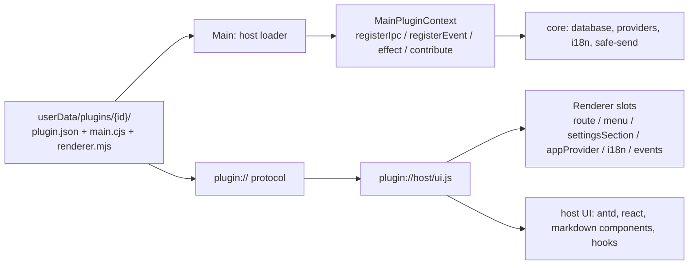
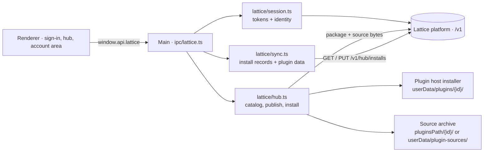
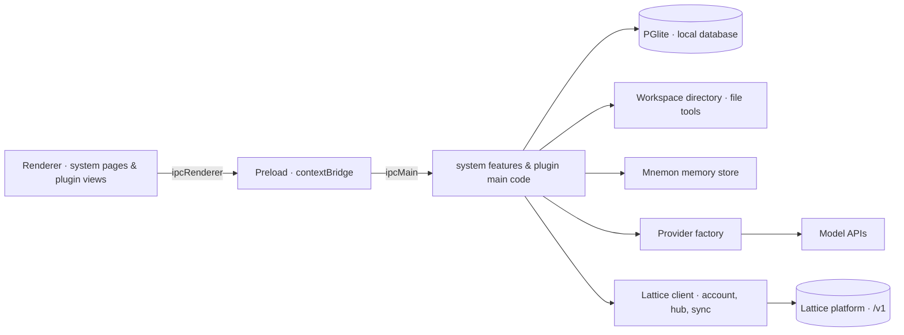

<p align="center">
  
</p>

<h1 align="center">RytenBench</h1>

<p align="center">An AI-powered personal desktop workspace — documents, knowledge bases, todos, knowledge graphs, an agent workbench and a plugin hub, in one Electron app.</p>

<p align="center">
  
  
  
  
  
  
</p>

---

## Overview

RytenBench is a cross-platform Electron desktop application that puts three things side by side:

- a **notes workspace** — Markdown documents, knowledge bases with a directory tree, todos, and an
  LLM-built knowledge graph;
- an **AI assistant workbench** — multiple workspaces, per-workspace conversations driven by an
  in-house agent runtime with streaming, tool calling, sub-agents, background jobs, OS-level sandboxed
  command execution and a three-layer memory system;
- a **plugin hub** — an optional Lattice account for browsing, installing, publishing and syncing
  plugin state across machines, where each published version also carries its source so the
  assistant can modify the plugin.

The flagship surfaces — **Notes**, the **AI assistant** and the **plugin hub** — are **core
features**, not plugins: their code is part of the main and renderer trees themselves
(`src/main/**`, `src/renderer/src/**`) and is compiled into the application. They never enter the
plugin registry and have no install, enable or uninstall step. Notes and the assistant register the
ordinary `harness:*` / `notes:*` namespaces from `src/main/system/` and are reached through
`window.api.system`; the hub registers the core `lattice:*` namespace from `registerCoreIpc()` and
is reached through `window.api.lattice`. The core process owns the window / tray / theme / i18n
shell, the system-feature wiring, the Lattice client (account, catalog, publishing, sync), the
PGlite database engine, the model provider factory and the generic preload bridge. Everything else
is a **plugin** — third-party extensions loaded from on-disk packages (`userData/plugins/<id>/`)
through the plugin host, which can be enabled, disabled or uninstalled at any time. Plugins arrive
from the hub or from a local package, and both paths end in the same host installer.

---

## Features

### Notes — system feature

- **Dashboard** — a landing view with a time-aware greeting, recent documents, open todos and
  overdue counts, plus quick entry points into the document tree.
- **Document tree** — hierarchical documents and directories with in-tree search across documents,
  todos and knowledge bases; create, import, delete and archive documents.
- **WYSIWYG Markdown editor** — built on TipTap v3 with bidirectional Markdown conversion:
  a slash (`/`) block menu, tables, task lists, code blocks with syntax highlighting, KaTeX math
  and Mermaid diagrams with pan/zoom controls. MDX constructs (`import` / `export` / JSX) survive
  both editing and preview untouched. Pasted and dropped images are compressed on the fly
  (screenshots stay PNG, other formats become JPEG q0.85, GIF is passed through). Debounced
  auto-save plus `Ctrl+S`, a save-state indicator, a breadcrumb bar and an outline panel that
  scrolls in sync with the document.
- **Documents** — title, summary, tags and per-document properties; import from `txt` / `md` /
  `docx` / `html` (DOCX via mammoth, HTML article extraction via Readability, both converted to
  Markdown), export back to Markdown.
- **Knowledge bases** — wikis with a nested directory tree, summaries, tags and cover images.
  Documents are linked into directories through a many-to-many model, so one document can live in
  several knowledge bases; an archive dialog moves a document straight into a chosen directory.
- **Todos** — priority, status, category and Markdown body, with a dependency graph between tasks.
  The notes view has a dedicated todo pane next to the outline panel.
- **Knowledge graph** — extracted from the documents of a knowledge base by the configured model:
  heading-aware chunking, entity and relation extraction with cached LLM calls, cross-chunk entity
  merging, an optional gleaning second pass, and incremental appends when new documents are added.
  Rendered on an ECharts canvas with an entity detail panel and persisted node positions; build
  progress streams into a floating progress overlay. Build parameters (concurrency, chunk size,
  gleaning threshold) and the graph / embedding models are configured in Settings → Graph.

### AI assistant — system feature

- **Workspaces** — each workspace is bound to a real directory on disk. Conversations (topics),
  messages, sub-agent configuration and memory are isolated per workspace; switching workspaces
  never leaks history or memory between them.
- **Conversation list** — the sidebar lists workspaces and their conversations. A conversation's
  `⋯` menu pins it to the top, renames it, forks it into an independent copy (topic row plus every
  message, so the two histories then diverge), opens its workspace in a detected editor
  (File Explorer, IntelliJ IDEA, PyCharm, WebStorm, GoLand, DataGrip, CLion, VS Code, Cursor —
  located through the Windows uninstall registry / `PATH`, `/Applications` and `~/Applications` on
  macOS, or the `PATH` / JetBrains Toolbox launchers / snap / flatpak on Linux; the file manager
  entry is called Explorer, Finder or File Manager depending on the platform and every entry shows
  the app's own system icon, extracted with Electron's `getFileIcon`),
  archives it into the collapsible **Archived** section at the bottom of the sidebar (a single list
  across workspaces, sitting right above the memory block), or deletes it. Opening an archived
  conversation is read-only: the transcript stays visible but the composer is not rendered at all
  (no hint bar) and message actions are reduced to copy. Pin and archive never touch the activity timestamp,
  so unpinning or unarchiving puts the conversation back where it was.
  Rename / fork / archive are also bound to `Ctrl+Alt+G`, `Ctrl+Alt+F` and `Ctrl+Shift+A`
  (`⌘` on macOS) while the assistant page is open.
  The search button in the sidebar header searches the current workspace by **conversation title
  and message body**: title matches are listed as conversations, body matches show the topic plus a
  snippet around the keyword; clicking a body match opens that conversation, scrolls to the exact
  message (loading older pages when needed) and flashes it briefly.
- **Streaming conversation** — token streaming with a typewriter renderer, reasoning (thinking)
  display, tool-call cards with an on-demand detail viewer, and a per-turn usage panel (provider /
  model, cached vs. uncached input, cache reads and writes, output, reasoning share, call count).
- **Input & attachments** — file reference chips, drag-and-drop or pasted images (with a vision
  capability check against the selected model) and a message queue: sending while a turn is
  running parks the message in a dock where it can be edited, removed or injected into the running
  turn immediately.
- **Goals** — a long-running objective can be persisted on the topic; the goal bar shows phase
  (active / paused / blocked / complete) and round progress, and automatic continuations are
  rendered as their own rounds in the transcript. Typing `/` as the first character of the
  composer opens the **command menu** (a grouped "Add" list in the style of the reference:
  icon, title, command alias and description): **Goal** turns the composer into an objective
  input with a **round-limit** field (empty = the default 256), and the goal bar's `⋯` menu
  pauses, resumes, completes or clears the objective.
- **Plan mode** — the same command menu's **Plan** entry toggles a per-topic mode (persisted
  across restarts). While it is active the system prompt asks the model to explore and design
  first, then submit the completed plan through an `exit_plan_mode` tool; the plan opens in a
  review dialog where it can be approved (plan mode ends and execution starts from the next step)
  or sent back with feedback for another revision. The composer shows a plan-mode badge while
  the mode is active.
- **Sub-agents & background agents** — named agents with their own system prompt, tool selection
  and memory directory; the main agent can delegate through a task tool, and background agents run
  in parallel with a merged "team" entry in the top bar that summarises subagents and shared tasks.
  Agents can be configured in More → Agents, or **built by the main agent itself** through an
  `agent_create` tool (validated and persisted to the workspace, editable in More → Agents, usable by
  `task` in the same turn). Opening a background agent from that entry (or from its "dispatched"
  card in the transcript) switches the conversation pane to its **live streaming transcript** — same
  message rendering and tool cards as the main conversation, breadcrumb and one click back to the
  main agent in the top bar, plus a bottom composer to send follow-ups into the same inbox (queued
  while it is running, with a stop control for the current turn). Viewing history never
  re-activates the agent. Subagent sessions persist their transcript snapshots, so after an app
  restart the history is still viewable as an inactive session; the first follow-up automatically
  cold-resumes it (rebuilds the model/tools/system prompt from the persisted configuration snapshot, preferring the provider/model descriptor recorded at spawn)
  and continues the same conversation. Long transcripts open on the latest 20 turns and scroll-load
  older turns on demand instead of shipping the whole history in one IPC payload.
- **Background commands** — `execute` takes a `run_in_background` option for long-running
  processes (dev servers, watchers): the tool returns a job id immediately instead of blocking the
  turn, the model keeps working and reads output incrementally with `job_output` / stops it with
  `job_kill`, and an inline top-bar tray lists every background command with collapsible per-task
  output and a stop control while the task is running.
- **Persistent terminal** — `terminal_open` / `terminal_send` / `terminal_read` / `terminal_close` /
  `terminal_list` keep one shell session alive across calls, so `cd`, environment variables and
  virtualenvs persist (unlike one-shot `execute`). The session layer appends a per-command completion
  marker, splits output incrementally, keeps a bounded 256 KB ring buffer and terminates the whole
  process tree on close, on 10 minutes of idleness and on app quit. Because the shell is not
  sandboxed, `terminal_open`/`terminal_send` only work in the **full access** permission mode.
  The same sessions are reachable from a **right-side terminal panel** (top-bar terminal button,
  docked in the same column as the workspace panel): opening the panel automatically creates a
  session when there is none, and the terminal is a **real PTY** — rendered by the open-source
  **xterm.js** (`@xterm/xterm` + fit addon) and backed by **node-pty** in the main process, so
  prompts, echo, ANSI colours, Ctrl+C, window resizing, scrollback and full-screen interactive
  programs (vim, top, …) behave like a native terminal. Hiding the panel keeps PTY processes alive
  and replays their buffer on reopen; closing a tab kills that session. The panel belongs to the
  human and is **not limited by the conversation's permission mode** — only the model-facing
  `terminal_open`/`terminal_send` tools (which keep their own line-mode sessions) require full
  access. When a conversation has no workspace (or none is selected) the terminal opens in the
  user's home directory.
- **Programmable tool calls (PTC)** — `run_code` runs a JavaScript snippet in a `node:vm` context
  where `await tools.<name>(args)` calls the read-only tools (`read_file`, `grep`, `glob`, `ls`,
  `read_image`, `web_fetch`, `web_search`, `session_search`, …), so the model can loop, filter and
  aggregate results in one call instead of many round trips. Console output and the returned value
  are captured (capped at 20k/50k characters), synchronous work is limited to 5 s, the whole call to
  120 s with at most 200 tool calls. `node:vm` is not a security boundary, so like the terminal it
  only works in the **full access** permission mode.
- **Next-step prefill** — `propose_action` offers 1–4 next actions without leaving anything in the
  transcript: while the proposal is pending the composer is replaced by a single editable input
  bar pre-filled with the first action's `reply` (falling back to its label). Enter / `›` sends
  the text through the normal send path (queued when a turn is already running); `✕` dismisses it
  without sending. The message flow renders no card, so history only shows what was actually sent.
- **Inline questions** — `ask_user_question` pauses the turn and opens a panel **inside the
  composer area instead of a separate window**: single/multi choice with a fixed "Other" free-text
  option, free-form questions, and several questions walked one at a time (Previous / Next /
  Submit). Submitting resumes the same turn. **Cancel does not end the turn** — the model receives
  `cancelled: true` and continues on its own, and the composer becomes editable again immediately.
- **Model routes for subagents** — `list_subagent_models` lists the enabled `provider:model` routes
  with a capability summary (image input, tool calling, reasoning) and marks the default, so
  `agent_create` and subagent configurations can pick a valid route instead of guessing; omitting the
  model inherits the main model.
- **Parallel & bounded tool calls** — when one model reply requests several read-only calls (read,
  glob, grep, `web_fetch`, …), they run concurrently instead of one after another; any write,
  command or unknown call forms a barrier and keeps the reply's order. Tools may declare a
  cooperative `timeoutMs`; a call that outlives it returns a readable timeout result and the turn
  continues instead of hanging.
- **Multi-file patches** — `apply_patch` applies Add / Update / Delete sections across several files
  in one call (`*** Begin Patch` … `*** End Patch`); the whole patch is validated in memory first, so
  a hunk that does not match writes nothing, and accepted changes still land in change review.
  Context matching tolerates trailing whitespace only (indentation stays strict). A companion
  `str_replace_editor` adds line-numbered `view`, `create`, unique `str_replace` and
  line-indexed `insert` for smaller line-oriented edits.
- **Image results** — `read_image` returns the picture itself to the model; the tool card shows a
  thumbnail with click-to-preview, the image is stored with the message so it survives a restart,
  and history replay re-attaches the most recent tool images (bounded, like user pastes) so later
  turns can still look at them. Before a picture enters the conversation it is downscaled /
  re-encoded to the context budget (long edge ≤ 2048 px, ≤ 1.5 MB) — the same rule applies to
  `read_image` results and to images pasted or uploaded into the composer, and the file on disk is
  never modified.
- **Deliverables** — a `present` tool lets the model declare the finished files of a turn (1–4
  workspace paths with one-line descriptions); the reply then shows a clickable file list that opens
  each file in the workspace panel. Optional tool: pick it under the chat input (it is off until
  selected there, like every other tool).
- **Conversation recall** — the sidebar search covers conversation titles and message bodies for
  humans; for the model, `session_search` searches every conversation of the workspace for a
  literal keyword and returns the newest hits (topic id/title, role, time, a snippet around the
  match); `conversation_list` lists the most recent conversations (id, title, last update, archived
  flag) and `conversation_read` then reads the last N messages of a topic. All are read-only and
  workspace-scoped, so the assistant can follow a reference back to an earlier discussion.
- **Scheduled tasks** — `schedule_create` / `schedule_list` / `schedule_view` / `schedule_edit` run a
  prompt in its conversation on a one-off timestamp, every N minutes, or daily at `HH:MM`. Tasks live
  in the local database (`scheduled_tasks` / `scheduled_task_runs`, run history kept forever), fire a
  fresh turn when due while the app is running (missed runs are skipped, not replayed, and the live
  transcript mounts the scheduled turn immediately), and are managed from the sidebar **Schedules**
  page: card list with pause / resume / edit / delete and a permanent run-history viewer. A task's
  target is independent of the mode the app is currently in: pick **chat / work / plugin**, then an
  existing conversation of that mode (across workspaces) or **"new conversation"** to open a fresh
  conversation on every run. The new-task dialog also carries a per-task tool / skill / MCP selection.
  The old Settings → Schedules tab was removed in favour of that page.
- **Agent Teams & shared task board** — the main agent and its subagents coordinate through one
  task board (`team_task_create` / `team_task_list` / `team_task_claim` / `team_task_update`):
  tasks carry status, owner, `blockedBy` dependencies, advisory `writeScopes` and optimistic
  `revision` checks, so parallel workers claim one task at a time instead of colliding. The top bar
  shows live in-progress / pending / completed progress with owners and blockers; the task section
  header summarises the team's progress counters and each subagent row shows its current task count
  plus its accumulated token usage once the model reports it.
  Every create/claim/complete/update/delete is appended to a `team_task_event` log and the panel
  footer shows the most recent activity. Team membership
  is the existing subagent tree, not a separate agent type. Agent teamwork is opt-in per
  conversation (enable/disable it from the composer's model menu; off by default, matching DSH), and
  when disabled the `team_task_*` tools and team prompt section are not injected at all. The board
  is persisted as a per-topic JSON snapshot (`team_board`) and lazily rehydrated after a restart,
  including task ids, revisions, owners and tombstones. See
  [`docs/agent-teams-alignment.md`](docs/agent-teams-alignment.md) for the current status matrix
  (subagent capabilities, configuration, Agent Teams, remaining gaps).
- **Workflow orchestration** — a workflow tool lets the model write a JavaScript orchestration
  script (top-level `await`, `agent` / `pipeline` / `parallel` / `phase` / `log` / `args` hooks)
  that fans work out across many one-shot sub-agents, executed in a `node:vm` sandbox with no
  filesystem, network or timers, and with concurrency and total-agent caps.
- **Context compaction** — history is kept inside the model window by two mechanisms: a
  zero-cost tool-result pruner applied when history is replayed, and LLM summarisation that folds
  the oldest exchanges into a structured checkpoint persisted per topic and reused until the
  compaction boundary advances again.
- **Memory (Mnemon)** — a three-layer memory system in every workspace: runtime memory (a user
  profile plus a project memory file, injected every turn), project documents (Markdown archives
  with hot/cold tiering) and long-term memory spaces (graph relations with deep recall, backed by
  PGlite). It is exposed to the model as 13 `mnemon_*` tools and is configurable under
  More → Memory.
- **Skills** — a local directory of skills, where every sub-directory containing a `SKILL.md`
  (YAML frontmatter with `name` / `description`) is a skill. Skills are **never enabled by default**:
  pick them under the chat input (or in a scheduled task); only picked skills enter the system
  prompt as a short name/description index, and their full instructions load on demand through a
  `skill` tool, so the prompt never carries every skill body at once. More → Skills lists every
  skill with search; click a card to read the skill body (frontmatter stripped), or use its
  edit/delete actions to manage the raw `SKILL.md` file.
  In tool pickers the four scheduled-task tools appear as one **Schedules** choice and the MCP
  tools/resources as one **MCP** choice; selecting a choice expands to the underlying tools at run
  time, so the lists stay short and readable.
- **MCP servers** — connect Model Context Protocol servers over stdio (a local command such as
  `npx` / `uvx`, with arguments, working directory and extra environment variables) or over
  Streamable HTTP / SSE (URL plus request headers). Servers connect when added but their tools are
  **not injected by default**: choose the servers to use under the chat input (the MCP picker next
  to the Tools and Skills pickers) or in a scheduled task; the tools then join the same tool-call loop as the
  built-in and plugin tools. Connected servers' **resources** are readable too:
  `list_mcp_resources` / `list_mcp_resource_templates` / `read_mcp_resource` return text inline and
  turn image resources into viewable attachments. Managed under More → MCP, where each server card
  also has a **resource browser**: it lists that server's resources and resource templates and
  previews text or image content in place (same read-only calls as the tools).
- **Web access** — two optional tools join the same tool loop: `web_fetch` retrieves one HTTP(S)
  URL and returns its readable text (HTML is reduced to Markdown, JSON/plain text pass through;
  local and private addresses are refused, responses are capped at 2 MB and 24k characters) and
  `web_search` runs 1–10 queries and returns title / URL / snippet rows for a follow-up
  `web_fetch`. Search providers are pluggable behind one interface and configured in
  **Settings → Web search**: the keyless built-in search (default fallback), DeepSeek's search API
  and Tavily (official SDK). Provider keys are AES-256-GCM encrypted with the machine key and only
  ever shown as a mask (first 6 + last 6); the default provider, automatic fallback and "request
  page content" behaviour are global settings. Both tools are off until selected under the chat
  input (or in a scheduled task).
- **Document reading** — `read_document` extracts text so Office attachments stop being binary
  black boxes: Word (`.docx`) plain text, Excel (`.xlsx`) every sheet as tab-separated rows,
  PowerPoint (`.pptx`) text per slide, plus plain-text formats (`csv`/`tsv`/`md`/`txt`/`json`/`yaml`).
  Output is capped at 20k characters by default and PDF is not supported yet.
- **Workspace files** — file explorer and CodeMirror 6 editor (with a Markdown rich/source toggle,
  language modes, search, folding, word wrap and caret/selection status) inside the assistant view,
  live-reacting to on-disk changes and warning when a file changed on disk while unsaved edits
  exist.
- **Change review** — every write the agent performs is recorded: before-image snapshots on disk
  plus per-file change history. The diff view supports per-hunk Keep / Revert, Keep all and
  Revert all, and older revisions can be inspected without losing the pending review.
- **Sandboxed commands & permission modes** — every session runs under one of three modes —
  **Read only** (`read-only`), **Workspace write** (`workspace-write`, the default) and
  **Full access** (`danger-full-access`) — and the `execute` tool wraps shell commands in an
  OS-level sandbox:
  a restricted token with capability SIDs on Windows, a self-built Landlock launcher (or `bwrap`
  when it is installed) on Linux, and the system `sandbox-exec` on macOS. A write outside the
  workspace is refused by the kernel and comes back to the model as a `[sandbox: …]` marker; when
  no backend is available the command is **not** run, with no unsandboxed fallback. Risky commands
  are shown for approval first, and a denied call can be retried once through the narrowly wider
  mode with an explicit prompt.
- **Failure recovery** — when a model request fails, a recovery dialog lets you switch to another
  configured model and resume from the interruption point: the prompt is not resent and completed
  tool calls are not re-run.

### Plugin hub & account — core feature

- **Optional sign-in** — a full-window sign-in page (`/login`) exchanges a username and password
  for a session on a Lattice node; the server address is editable under an advanced disclosure.
  The app stays fully usable as a guest — the assistant, the Library and local plugin installs need
  no account — while the hub catalog, publishing and cross-device sync do. "Remember me" stores
  only the username and the server address, never the password.
- **Sessions & device binding** — the access token lives in memory only; the refresh token is
  persisted, encrypted through the OS keystore when `safeStorage` is available (with a logged
  plaintext fallback where it is not) and tied to the node that issued it, so switching servers
  drops the old session. Startup restores and refreshes the session; a rejected refresh signs the
  user out, while a network failure keeps the session so an offline start does not sign anyone out.
  Sign-in registers a per-install device fingerprint and device name with the platform.
- **Account area** — the sidebar footer shows the avatar, display name, role and live sync state,
  plus a badge with the number of unresolved conflicts. Its menu opens account details (user id,
  server, last sync, conflict count), jumps to the plugin hub, runs a sync on demand and signs out.
- **Hub catalog** — plugins published on the platform with version, author, tags, download count,
  install state and a source marker; search matches name, id, description, category, author and
  tags, and the category filter narrows the list. A card installs or updates one plugin, and
  "Update all" upgrades every outdated plugin, continuing past individual failures.
- **Version history & downloads** — each published version lists its size, source size, publish
  date and changelog, can be installed directly (so a machine can be pinned to an earlier version)
  and can be downloaded as a package or source archive after a checksum check. The README of a
  published plugin is rendered on its detail page.
- **Publishing** — publish a package folder or a `.zip`, publish a new version straight from the
  local source folder (version plus changelog), or import a folder and batch-publish the plugin
  directories inside it (one plugin, a repository of plugins, or a `dist/<id>` layout). Packaging
  and upload report per-phase progress (packaging → metadata → bytes). Who may publish is left to
  the platform; the client has no separate admin mode.
- **Source on disk** — installing a version that ships source also unpacks the source on this
  machine, under the plugin workshop's storage path (falling back to `userData/plugin-sources`),
  writes a `source.json` marker and backs up user-modified source before replacing it. "Edit in
  chat" opens that folder as a plugin workspace and conversation so the model can modify the
  plugin; when a chat cannot be created it opens the folder and reports that instead.
- **Cross-device sync** — install records (version, enabled state) and each plugin's data snapshot
  sync with the platform. A plugin that contributes a sync snapshot decides what goes in it (the
  personal ledger exports its settings plus its ten business tables); the app falls back to
  `userData/plugin-state/<id>.json` (≤ 256 KiB) when a plugin has no snapshot of its own. Plugins
  apply incoming snapshots with replace semantics, so syncing repeatedly never duplicates rows.
  Plugins can also contribute a non-destructive `merge()`: when two machines edited the same
  plugin independently, "Merge both sides" keeps local data and adds cloud-only rows
  (deduplicated by the plugin's natural keys), then pushes the union back; "Merge cloud data"
  in the sync bar does the same for every installed plugin on demand.
  Workspace files, chat history, notes and databases never leave the machine. The app pulls at
  startup, after sign-in, every 60 seconds while signed in, and when the window regains focus;
  it pushes five seconds after a plugin changes, and offers a manual "Sync now". Sync results
  report both plugin counts and record counts (e.g. pushed 4 plugins / 37 records).
- **Account-scoped local data** — plugin data and the plugin database live in a per-account
  container (`userData/profiles/<key>/`, where key = base URL + user id); the signed-in account's
  container is swapped into the root at startup. Signing in, signing out or changing the base URL
  swaps containers **in place** — the app pauses sync and streaming, closes the database, moves the
  directories, reopens the account's database, reloads plugins and refreshes the window, without
  restarting the process. Only when that is not possible (during very early startup) or fails (a
  file still held open by another process) does it fall back to `app.relaunch()`. Signed-out usage
  gets its own `anonymous` container and is never merged into an account implicitly. So two accounts
  on one machine never see or upload each other's plugin data.
- **Auto-restore** — the default-on "Auto-restore plugins" switch makes a pull reinstall plugins
  the account has install records for but this machine is missing (a new machine, a reinstall, a
  deleted folder). Per-plugin failures are itemised instead of aborting the rest, and switching it
  off makes a pull only list what is missing.
- **Conflicts & orphaned records** — plugin-data conflicts (`data_rev` changed on both sides) are
  recorded, never force-overwritten: a dialog shows the local and cloud revisions and lets the user
  keep either side. Install records whose plugin was removed from the hub are marked orphaned and
  their local plugin and data are left untouched. A sync-details dialog lists restored plugins,
  failures, orphaned records and conflicts.

### Model providers

- Multiple providers and models with **AES-256-GCM encrypted API keys**, encrypted with a
  machine-specific key — credentials are bound to the machine that created them.
- Protocol-based configuration: pick a known platform or type any protocol identifier, and any
  unknown protocol is called in an OpenAI-compatible way. Custom endpoints can be OpenAI- or
  Anthropic-compatible.
- **Model profile autofill** — model IDs are matched against a bundled `models-profile.json`
  while typing, filling in the official display name, context window, max output and capability
  flags; anything unlisted can be filled in by hand.
- Fetch a model list from any OpenAI-compatible endpoint (`GET /v1/models`) and add models in
  batches, set a default chat model (and a separate default embedding model), pin favourites,
  and tune sampling parameters (temperature / top-p / top-k), thinking mode, image input support,
  context window, max output and per-conversation tool-call rounds.

### Application shell

- **Native window chrome** — on Windows the window is a plain system window: the native title bar
  carries the app icon, the name RytenBench and the system minimize / maximize / close buttons, and
  the app's light / dark choice is pushed to the system title bar and the DWM window border so the
  frame never keeps the wrong colour. macOS keeps `titleBarStyle: hiddenInset` with the traffic
  lights plus a slim self-drawn App / Edit menu strip; Linux uses the native frame.
- **Shell** — a themed sidebar (brand and version, Library / Plugin repository / More navigation,
  the assistant's conversation sidebar with its mode switcher, workspace tree and memory, and a user
  dock with the account block, notification popover, Settings and a light / dark toggle) next to the
  content area. The account block is the plugin hub's face in the shell: a guest button that leads
  to sign-in, or the signed-in avatar, display name, role, live sync state and conflict badge above
  its account menu. The old frameless shell — bottom bar, right bar, plugin-registered navigation —
  is gone; plugin routes still render in the content area but no longer own the chrome.
- **System pages** — the assistant (`/harness`, the default route), Library (`/notes`), Plugin
  repository (`/plugins`, with a per-plugin detail page at `/plugins/:pluginId`) and More
  (`/more/:tab`), with the shared assistant sidebar on the left. The sign-in page (`/login`) is the
  one full-window route: no sidebar, user dock or title strip.
- **More** — the assistant's own settings pages (Agents, Skills, Memory and MCP) are standalone
  screens under `/more/:tab`, chosen from the sidebar's More dropdown and laid out as a hero header
  above the same settings cards; the Settings modal no longer carries an assistant group.
- **Weather** — local conditions and a three-day forecast from Open-Meteo, located through IP
  geolocation and cached by the main process (exposed through `window.api.weather`).
- **Settings** — a single-group modal: General (interface language, theme, tray behaviour, lock
  screen), Models, Graph and System. Plugin management lives on the Plugin repository's detail
  page; the plugin workshop and third-party plugin settings pages are dialogs inside Plugin
  repository; Settings itself only holds the app's own configuration.
- **Localization** — Simplified Chinese and English, switchable at runtime without restart, and
  the main process renders tool output and progress text in the current language too.
- **Theme** — light / dark / auto, where auto follows the time of day (light from 6:00 to 18:00).
- **Lock screen** — an optional 6-digit passcode (salted scrypt, verified in the main process,
  never exposed to the renderer) that locks on app launch, on Esc, on minimize or hide-to-tray
  and after the configured system idle period. The locked state lives in the main process, so a
  page reload, a renderer crash or an app restart cannot unlock it; the digits are masked in
  every passcode field, the app content is blurred at 64px behind a full-screen frosted overlay
  and the window is excluded from screen capture until unlocked. Changing the passcode verifies
  the old one in the main process, and repeated failures back off exponentially.
- **Settings safety net** — every settings change is copied to `settings.backup.json`. At startup
  a missing or corrupt `settings.json` is restored from that backup (invalid files are archived,
  not deleted), so deleting the settings file cannot silently disable the lock screen.
- **System tray** — closing the window can keep the app resident in the tray (restore or quit from
  the tray menu); single-instance behaviour focuses the existing window instead of starting a
  second copy.
- **Startup & failure handling** — the main window is created and shown immediately, covered by an
  in-app startup splash (mascot, current task, progress) fed over IPC while the main process
  initialises the database, migrations, workspace and plugin host in the background; the splash
  reports a failed initialisation instead of leaving a blank window, and fades into the interface
  once the first frame is ready. Around that: a renderer error boundary that offers a reload,
  renderer-crash recovery that rebuilds the main window, crash dumps collected locally
  (`userData/Crashpad/reports`, never uploaded), and a database recovery path that can back up and
  restart from an empty database if PGlite fails to open.

---

## Plugins

Plugins are third-party extensions. They are not bundled with the app, they are loaded from
on-disk packages (`userData/plugins/<id>/`) through the plugin host, and they can be enabled,
disabled or uninstalled at any time. They are installed from the **Lattice plugin hub** or from a
local package.

Notes, the AI assistant and the plugin hub are **not** plugins: they are core features compiled into
the application (see [Features](#features)), so they never appear in the registry below.

| Plugin         | What it provides                                                      |
| -------------- | --------------------------------------------------------------------- |
| `task-planner` | Planner with a Gantt chart and hierarchical task tree                 |
| `music-player` | Folder playlists, playback controls, mini player, metadata extraction |

Both are published on the Lattice platform and are installed from the in-app plugin hub (route
`/plugins`) or from a locally built package. A fresh install therefore has an empty plugin registry
until the user installs one.

### Installing and publishing plugins

1. **Plugin hub** — sign in with a Lattice account and the `/plugins` page lists the plugins
   published on that platform. Installing a version downloads its package over a presigned URL
   (the access token is not forwarded to object storage), verifies its `sha256`, unpacks it
   (rejecting path traversal), validates `plugin.json` and installs it into
   `userData/plugins/<id>/`. Versions can be upgraded or rolled back one at a time from the
   version history; "Update all" walks every outdated plugin. A version that ships source also
   unpacks that source for editing (see
   [Plugin hub & account](#plugin-hub--account--core-feature)).
2. **Local install** — install from a local `.zip` package or an unpacked plugin folder; this needs
   no account.
3. **Publishing** — publish a package folder or a `.zip`, publish a new version from the local
   source folder (version plus changelog), or import a folder and batch-publish the plugin
   directories inside it. A publish uploads the installable package and the matching source archive
   together, so the plugin stays editable on whichever machine installs it.

The legacy static-index distribution path is **gone**: there is no `plugins.json` / Release-asset
download code left (its IPC channels, URL rules and installer module were removed), so the hub — plus
local installs — is the only source of plugins.

A plugin can be **enabled / disabled** at any time: disabling it unloads its routes, menu entries,
settings pages, providers, IPC channels, event channels, i18n resources and AI tools immediately.
**Uninstalling removes its code**: the plugin detail page always keeps the plugin's data, while the
plugin workshop's draft uninstall offers an opt-in "also delete all data" checkbox (each plugin
declares what that would remove). Data is therefore still there after reinstalling unless it was
explicitly purged.

### Plugin package layout

Third-party plugins use the shape below; the host-side loader and installer in this repository
(`src/main/plugins/`) and the in-app workshop (`src/main/workshop/`) work with any directory
following it:

```
<id>/
  plugin.json            id / name / version / description / icon / entry files
  main.cjs               bundled main-process entry (install(ctx))
  renderer.mjs           bundled renderer entry (default { manifest, install(ctx) })
  chunk-*.mjs            lazy chunks
  plugin.css             optional styles, injected by the plugin host
```

`icon` is a Remix Icon name, a `plugin://<id>/icon.svg` URL or a `data:` URI; hub cards, the detail
page and the plugin's sidebar menu all render it, and a stable colour-plus-glyph fallback derived
from the plugin id is used when nothing usable is declared.

Source layout before bundling, as used by the companion repositories:

```
<id>/
  manifest.ts            id / name / version / description / icon / inject / routes / menu
  main/
    index.ts             export function install(ctx: MainPluginContext)
    ipc/                 this plugin's IPC channels (ctx.registerIpc)
    db/schema.ts         this plugin's Drizzle tables
    db/mapper.ts         row types and queries (through withOrm)
    services/**.ts       business services
  renderer/
    plugin.tsx           export default { manifest, install(ctx) }
    api.ts               thin wrapper over window.api.plugin.invoke/on
    Index.tsx            route page (lazy-loadable)
    components/ hooks/ utils/
  shared/**.ts           main/renderer DTOs
  locales/index.ts       zh-CN / en-US copy, registered with the plugin
```

Plugins are built **in the app** (workshop: `plugin_build` / `plugin_publish`) or with the plugin
repository's own build script; either way the result is a disk package
(`plugin.json` / `main.cjs` / `renderer.mjs` / `chunk-*.mjs` / optional `plugin.css`) that is
installed into `userData/plugins/<id>/`. The application ships **no** bundled plugins: there is no
`resources/plugins` in the installer and no `build:plugins` step.

### AI runtime (`src/main/ai/`)

The assistant does not use a third-party agent framework. `src/main/ai/` is a small, self-maintained
runtime that covers exactly the capability surface this application needs:

- `messages.ts` — `HumanMessage` / `AIMessage` / `SystemMessage` / `ToolMessage` / `AIMessageChunk`,
  including multimodal content blocks and the `usage_metadata` / `reasoning_content` fields the
  streaming and usage layers read;
- `tools.ts` — the `tool()` factory and `StructuredToolInterface`; zod schemas are converted to JSON
  Schema for each provider and validated before execution (invalid arguments are reported back to
  the model);
- `chat-model.ts` — the `BaseChatModel` contract: `invoke()` always streams internally and reports
  incremental chunks to the graph, `bindTools()` returns a lightweight wrapper so concurrent agents
  never mutate each other's tool sets. There is deliberately **no built-in retry** — retry budgets
  live in `runtime/harness/model-recovery.ts`. A provider that returns no text and no tool calls
  (an empty stream, or a gateway error page served with a 2xx status) is retried once with a
  **non-streaming** request before it is reported as an error, which keeps gateways whose streaming
  implementation is broken working (this is the mode Spring AI uses by default). If both attempts
  are empty, a `ModelEmptyResponseError` carrying the provider, model, `finish_reason` and both raw
  payloads is raised, so the real upstream failure is visible instead of a silent empty turn;
- `graph.ts` — a minimal state-graph engine (`Annotation` / `StateGraph` / `START` / `END`), including
  `streamMode: ['messages']` token chunks and `GraphRecursionError` for graceful round-limit handling;
- `output-parsers.ts` — `StructuredOutputParser` for the knowledge-graph extraction pipeline;
- `providers/` — one implementation per protocol: OpenAI-compatible (OpenAI, DeepSeek, xAI,
  OpenRouter, Mistral, custom endpoints), Anthropic Messages, Gemini, Vertex AI (Express Mode API key
  or service-account / gcloud ADC OAuth), Ollama (NDJSON), Bedrock Converse (bearer token or SigV4 +
  AWS event-stream) and Cloudflare Workers AI.

OpenAI-compatible providers are deliberately permissive, because gateways differ in the details:
both base-URL conventions work (a bare host is probed with Spring AI's `/v1/chat/completions`
first, a versioned or custom path keeps the OpenAI SDK's `base_url + /chat/completions`), the
stream parser accepts standard SSE, CR-only framing, bare NDJSON lines, JSON arrays and mislabeled
content types, and a gateway that rejects optional fields (`stream_options`, `thinking`,
`reasoning_effort`, …) with 400/422 gets one retry with a minimal, Spring-AI-equivalent request
body before the error is reported.

Plugins see the same implementation through `@host/main/ai/*`; the old `@langchain/*` specifiers are
kept only as legacy aliases in the plugin host table so already-published plugins keep loading.

### Host contract

Plugin packages never bundle their own copy of the database, React or i18n. At build time imports
pointing into the core or the host UI are rewritten to `@host/**` specifiers, and at runtime the
host injects the single instances it already has:

- **Main process** — `globalThis.__RB_HOST_RESOLVE__` resolves the host module table in
  `src/main/plugins/runtime.ts` (`@host/main/**`, `@host/shared/**` and the legacy `@langchain/*`
  aliases); other bare modules (electron, zod, drizzle, …) resolve to the host's own instances from
  the application root.
- **Renderer** — an ESM bridge served from `plugin://host/ui.js?m=<key>` exposes 15 host UI
  modules (i18n, hooks, Markdown components, settings UI, routing skeletons, utilities) plus 8
  vendored libraries (react, react-dom, antd, @remixicon/react, @ant-design/icons, dayjs) so
  provider contexts and component instances stay shared.

Main-process context API: `registerIpc`, `registerEvent`, `effect` (LIFO rollback), `contribute`
and `provide`. Renderer slots: `route`, `menu`, `settingsSection`, `appProvider`,
`globalComponent`, `api`, `i18n`, `events`, `storage` — plugin settings sections and the workshop
render as dialogs inside Plugin repository, and the shell slots of the old frameless UI (title bar,
bottom bar, right bar) are no longer rendered. Contribution points let plugins extend each other
without importing each other, and the same contract is reused by the system features: the assistant
pulls AI tools from `harness.tool` contributions (this is how the notes system feature exposes its
document, wiki, todo and graph tools to the model), and `plugin.purge` lets a feature or plugin
clean up its own data on uninstall.

Channel naming is namespaced as `plugin:<id>:<channel>`; the host validates ownership, rejects
duplicates, and pushes the authoritative channel list to the preload whitelist whenever plugins
are loaded or unloaded.

More detail lives in [`src/main/plugins/`](src/main/plugins/) (host, context, runtime table) and
[`src/main/workshop/README.md`](src/main/workshop/README.md) (draft → build → verify → publish, and
the `WORKSHOP.md` contract generated for every draft).

---

## Tech stack

| Layer            | Technology                                                                                                                                                                   |
| ---------------- | ---------------------------------------------------------------------------------------------------------------------------------------------------------------------------- |
| Framework        | [Electron](https://www.electronjs.org/) 44                                                                                                                                   |
| UI               | [React](https://react.dev/) 19 + [TypeScript](https://www.typescriptlang.org/) 5.9                                                                                           |
| Build            | [electron-vite](https://electron-vite.org/) 6 + [Vite](https://vite.dev/) 8                                                                                                  |
| Component system | [Ant Design](https://ant.design/) 6 + [Tailwind CSS](https://tailwindcss.com/) 4                                                                                             |
| Routing          | [React Router](https://reactrouter.com/) 7 (hash routing)                                                                                                                    |
| i18n             | [i18next](https://www.i18next.com/) 26 + react-i18next                                                                                                                       |
| Markdown editor  | [TipTap](https://tiptap.dev/) 3 + [tiptap-markdown](https://github.com/ueberdosis/tiptap-markdown)                                                                           |
| Markdown view    | [react-markdown](https://github.com/remarkjs/react-markdown) + remark-gfm + rehype-katex/highlight                                                                           |
| Diagrams & math  | [Mermaid](https://mermaid.js.org/) 11 + [KaTeX](https://katex.org/) + [highlight.js](https://highlightjs.org/)                                                               |
| Code editor      | [CodeMirror 6](https://codemirror.net/) via [@uiw/react-codemirror](https://github.com/uiwjs/react-codemirror) + [@codemirror/merge](https://codemirror.net/docs/ref/#merge) |
| Agent runtime    | In-house `src/main/ai` runtime (chat models, tools, messages, minimal state graph) — no third-party agent framework                                                          |
| Database         | [PGlite](https://pglite.dev/) 0.5 (PostgreSQL compiled to WebAssembly) + [Drizzle ORM](https://orm.drizzle.team/) 0.45                                                       |
| Settings store   | [electron-store](https://github.com/sindresorhus/electron-store) 11                                                                                                          |
| Graph rendering  | [ECharts](https://echarts.apache.org/) 6                                                                                                                                     |
| Validation       | [zod](https://zod.dev/) 4                                                                                                                                                    |
| Document import  | [mammoth](https://github.com/mwilliamson/mammoth.js) + [turndown](https://github.com/mixmark-io/turndown) + [Readability](https://github.com/mozilla/readability)            |
| Audio metadata   | [music-metadata](https://github.com/Borewit/music-metadata) (music plugin)                                                                                                   |
| Weather          | [open-meteo](https://open-meteo.com/)                                                                                                                                        |
| Icons            | [Remix Icon](https://remixicon.com/) + Ant Design Icons                                                                                                                      |
| Logging          | [electron-log](https://github.com/megahertz/electron-log)                                                                                                                    |
| Packaging        | [electron-builder](https://www.electron.build/) 26                                                                                                                           |
| Plugin hub       | Lattice platform: `/v1` REST over HTTP(S), device-bound token sessions, sha256-verified packages and sources                                                                 |
| Sandbox          | Self-built, no third-party dependency: Windows restricted token + capability SIDs, Linux Landlock or `bwrap`, macOS `sandbox-exec`                                           |

---

## Model protocols

| Protocol                      | Notes                                           |
| ----------------------------- | ----------------------------------------------- |
| OpenAI                        | Also the fallback for any OpenAI-compatible API |
| Anthropic                     | Claude models                                   |
| DeepSeek                      | Includes reasoning support                      |
| Google Gemini                 | Generative Language API                         |
| Google Vertex AI              | Google Cloud deployments                        |
| Mistral AI                    | Mistral models                                  |
| Ollama                        | Local models                                    |
| OpenRouter                    | Multi-model gateway                             |
| xAI                           | Grok models                                     |
| AWS Bedrock                   | Converse API                                    |
| Cloudflare Workers AI         | Edge-hosted models                              |
| Custom (OpenAI-compatible)    | Any `/v1/chat/completions`-shaped endpoint      |
| Custom (Anthropic-compatible) | Any Anthropic-shaped endpoint                   |

The model form also offers platform presets for common Chinese providers (Zhipu GLM, Alibaba
Cloud Bailian, Baidu Qianfan, Volcano Engine Ark, Tencent Hunyuan, SiliconFlow), which are
configured as OpenAI-compatible endpoints. A separate default embedding model is used for
knowledge base embeddings.

---

## Getting started

### Prerequisites

- [Node.js](https://nodejs.org/) ≥ 20.19 (or ≥ 22.12; Node 22 LTS recommended)
- [pnpm](https://pnpm.io/) ≥ 9 (CI builds with pnpm 10)

`.npmrc` points the Electron and electron-builder binary downloads at the npmmirror mirrors, which
helps on networks where the default hosts are slow. `postinstall` installs the Electron binary and
rebuilds native dependencies.

### Install and run

```bash
git clone https://github.com/Aitenry/RytenBench.git
cd RytenBench
pnpm install
pnpm dev
```

### Plugin hub server

The app runs without a Lattice account: the assistant, the Library and local plugin installs work
immediately. Signing in — from the sidebar's account block or the `/login` page — connects it to a
Lattice node for the hub catalog, publishing and cross-device sync.

The sign-in page's advanced **Server address** field points the app at a node; the default is
`http://127.0.0.1:8080`, a local development node. Point the field at your own deployment and sign
in with an account created there — until then the hub stays behind its sign-in prompt. The
`RB_LATTICE_URL` environment variable overrides the address for offline fixtures and internal
deployments and locks it: a value saved from the UI is still written to
`userData/lattice-settings.json` but no longer takes effect. The scheme follows the address, so use
an `https://` node outside local development.

### Scripts

| Command              | What it does                                                           |
| -------------------- | ---------------------------------------------------------------------- |
| `pnpm dev`           | Build the sandbox assets, then start the app with hot reload           |
| `pnpm build:sandbox` | Build the sandbox assets into `resources/sandbox/`                     |
| `pnpm build`         | Type-check and build the main, preload and renderer bundles            |
| `pnpm typecheck`     | `tsc --noEmit` for the node and web projects                           |
| `pnpm lint`          | ESLint over the repository (it also walks build output, so it is slow) |
| `pnpm build:win`     | Sandbox assets + app bundles + Windows NSIS installer                  |
| `pnpm build:mac`     | Sandbox assets + app bundles + macOS DMG and ZIP (not notarized)       |
| `pnpm build:linux`   | Sandbox assets + app bundles + Linux AppImage and DEB                  |
| `pnpm build:unpack`  | Unpacked directory build, useful for quick smoke tests                 |

A faster local lint that skips `dist/` and `node_modules/`:

```bash
npx eslint --cache src examples electron.vite.config.ts
```

> Sandbox assets are generated artifacts: `resources/sandbox/` is not committed, and packaging
> scripts run `build:sandbox` first. Sandbox sources live in `native/`, and CI runs its
> `--selfcheck` against the packaged app, so a build only ships when the sandbox inside the
> installer really enforces the write boundary. Plugins are **not** bundled with the app: they are
> installed at runtime from the plugin hub or from a local package (see
> [`src/main/workshop/README.md`](src/main/workshop/README.md)).

## Releases

Every push to `main` publishes a real version — there is no alpha channel and nobody edits the
version by hand. `.github/scripts/resolve-version.mjs` derives it from the last stable tag and the
commit messages:

| Change since the last release | Next version              |
| ----------------------------- | ------------------------- |
| `fix(...)`, `chore(...)`, …   | patch — `0.1.0` → `0.1.1` |
| `feat(...)`                   | minor — `0.1.1` → `0.2.0` |
| `BREAKING CHANGE:` / `feat!:` | major — `0.2.x` → `1.0.0` |

`[release:major|minor|patch]` in a commit message overrides the inference, and the first release
takes the version already in `package.json`. Development happens on a branch named after the version
(`0.1.0`, `0.2.0`, …), so release tags carry a `v` prefix (`v0.1.0`, `v0.1.1`): when a branch and a
tag share a name, git resolves the bare name to the tag, so `git merge 0.2.0` would silently merge
nothing. The build stamps the resolved version in before packaging, so installer file names and
`app.getVersion()` report it, and a release is published only when every platform artifact is
present and the sandbox inside the packaged app has passed its self-check. After a successful
publish the version is committed back to `main` as `chore(release): <version> [skip ci]`, which
never counts as a change; rerunning a workflow for an already published commit is a no-op.

---

## Project structure

```
RytenBench/
├── src/
│   ├── main/                         # Electron main process
│   │   ├── index.ts                  # Single instance, protocol, startup, windows, tray, host init
│   │   ├── lifecycle.ts  context.ts  safe-send.ts
│   │   ├── weather.ts                # Open-Meteo + IP geolocation, cached and pushed
│   │   ├── address/  crypto/  resource/  tray/  windows/
│   │   ├── database/                 # PGlite + Drizzle engine
│   │   │   ├── loading.ts  instance.ts  orm.ts
│   │   │   ├── schema/               # Core tables (+ harness/ and notes/ tables)
│   │   │   ├── mapper/               # Core row types (+ harness/ and notes/ queries)
│   │   │   ├── workspace-context.ts  # Active workspace for tools and IPC
│   │   │   └── workspace-migration.ts
│   │   ├── i18n/                     # Main-process copy (tool results, graph progress)
│   │   ├── ipc/                      # Core IPC + ipc/harness/** + ipc/notes/** + ipc/lattice.ts
│   │   ├── system/                   # System-feature wiring (Notes and the assistant)
│   │   │   ├── index.ts              # startSystemModules / stopSystemModules
│   │   │   ├── harness.ts            # AI assistant: channels, workshop/MCP/workspace wiring
│   │   │   └── notes.ts              # Library: channels + built-in AI tools
│   │   ├── ai/                       # In-house AI runtime: messages, tools, chat models, graph
│   │   ├── runtime/harness/          # Agent runtime: graph loop, mnemon, permissions, jobs
│   │   ├── services/harness/         # Stream handling, queues, caches, snapshot, purge
│   │   ├── services/notes/           # Library data cleanup
│   │   ├── tools/harness/  tools/notes/   # Tool registry and implementations
│   │   ├── sandbox/                  # OS-level sandbox backends (Windows / Linux)
│   │   ├── workshop/                 # Plugin workshop: build / verify / publish
│   │   ├── workspace/                # File history, workspace watcher, line diff
│   │   ├── graph/                    # Knowledge-graph extraction pipeline
│   │   ├── provider/                 # Multi-protocol chat model factory, cache, model tags
│   │   ├── plugins/                  # Plugin host: contexts, loader, installer, protocol
│   │   ├── lattice/                  # Lattice account + hub: client, session, hub, sync, sources
│   │   └── shared/  types/
│   ├── preload/                      # contextBridge: core APIs + system / plugin / lattice bridges
│   ├── renderer/
│   │   ├── resource/                 # index.html + window type declarations
│   │   └── src/
│   │       ├── api/                  # harness.ts / notes.ts channel wrappers (window.api.system)
│   │       ├── components/
│   │       │   ├── markdown/         # TipTap editor, Markdown view, Mermaid, math, MDX
│   │       │   ├── harness/          # Assistant UI: messages, panels, settings, workshop
│   │       │   ├── notes/            # Library UI: tree, editor, graph, todo, wiki
│   │       │   └── system/           # Shell: AppContent, shell/, settings/, PluginIcon, splash
│   │       ├── contexts/harness/     # HarnessProvider and workspace bridge
│   │       ├── events/               # doc-changed bus (assistant → library editor)
│   │       ├── hooks/harness/  utils/harness/
│   │       ├── i18n/                 # i18next setup + shell / harness / notes / lattice copy
│   │       ├── lattice/              # Renderer hub state: context, bridge, upload progress, avatar
│   │       ├── pages/                # Harness, Notes, More, Login, plugin repository, detail
│   │       ├── plugin-host/          # Renderer plugin host: slots, declarations, UI bridge
│   │       ├── providers/notes/      # Knowledge-graph build progress provider
│   │       ├── route/  types/  workshop/  # route table; workshop/ = renderer side of the plugin workshop
│   │       └── Root.tsx  App.tsx  main.tsx  window-title.ts
│   ├── shared/                       # Cross-process DTOs (plugin/, harness/, notes/)
│   └── plugins/                      # Plugin host: scanner, store, context, runtime table, protocol
├── native/                           # Self-built sandbox backends (no third-party dependency)
│   ├── build-sandbox.mjs             # Builds resources/sandbox, --selfcheck runs the packaged app
│   ├── win32-sandbox-runner/         # Windows restricted-token runner (JS + koffi)
│   └── landlock-launcher/            # Linux Landlock launcher (C, kernel ≥ 5.13)
├── resources/                        # Icons, tray assets, models-profile.json
│   └── sandbox/                      # Generated sandbox assets (not committed)
├── drizzle/                          # Generated migrations and snapshots
├── build/                            # electron-builder resources (macOS entitlements)
├── .github/workflows/                # Release builds for Windows, macOS and Linux (on main)
├── drizzle.config.ts  electron-builder.yml  electron.vite.config.ts
└── package.json  tsconfig*.json  LICENSE
```

---

## Architecture

### Processes

- **Main process** (`src/main/`) — application lifecycle, windows, tray, weather, the PGlite /
  Drizzle database engine, the model provider factory, the plugin host, the Lattice plugin hub
  (account session, catalog, publishing, sync), the startup sequence (`windows/startup.ts`) and the
  system-feature wiring (`system/`). `system/` starts the notes workspace and the AI assistant as
  plain core modules: their channels are the ordinary `harness:*` / `notes:*` namespaces,
  registered with `registerIpcHandlers` and torn down with them on quit. Core IPC covers window,
  settings, dialog, provider and plugin management plus the `lattice:*` hub channels; only
  third-party plugins go through the reversible `MainPluginContext` contract.
- **Preload** (`src/preload/`) — a context-bridged API surface: core capabilities, a **system
  bridge** (`window.api.system.invoke` / `on`, prefix-checked to `harness:` / `notes:`) for the two
  system features, a dedicated **lattice bridge** (`window.api.lattice.*`, fixed channel names) for
  the hub, account and sync, and a generic **plugin bridge** (`window.api.plugin.invoke` / `on`)
  for third-party plugins, gated by an authoritative channel list pushed from the main process.
- **Renderer** (`src/renderer/`) — a React 19 single-page app with hash routing, mounted under
  `Root.tsx` (the startup splash wraps `App.tsx`, and a `LatticeProvider` above the plugin host
  shares account, sync and upload state with the shell and the hub pages). The shell renders the
  sidebar, the system pages (assistant, Library, Plugin repository, More), the sign-in page, the
  settings modal and the notifications, and macOS additionally renders the self-drawn title strip.
  Assistant, Library and More are lazy routes (`pages/Harness`, `pages/Notes`, `pages/More`); Plugin
  repository, plugin detail and sign-in load eagerly; third-party plugin routes arrive through
  plugin registrations.

### Plugin host



Plugin lifecycles are reversible: an install returns a dispose function, effects are rolled back in
LIFO order, and IPC channels, event channels, contributions, i18n resources and UI slots are all
removed on disable, so a disabled plugin stops executing any of its hooks.

### Plugin hub and sync



The renderer never speaks HTTP to the platform: the main process holds the session and exposes only
typed `lattice:*` calls, so tokens stay out of the renderer. Installs reuse the same package kernel
as a local install (`src/main/plugins/package-install.ts`), which keeps checksum, path-traversal and
manifest validation identical for both paths, and source archives go through the same safe unzip.
`session`, `hub` and `sync` are wired through `configure*` hooks from `lattice/index.ts` for the
callbacks that would otherwise create import cycles, which keeps the module graph acyclic.

A sync round pulls before it pushes: pull applies cloud enabled flags, writes back newer plugin data
and can auto-install missing plugins; push writes every locally installed plugin's record and — when
the plugin has a state file — its data with the last-seen `data_rev`. A `409` on that revision is
recorded as a conflict for the user to resolve, never retried with `force`; `404` / `410` marks the
record orphaned and leaves local files untouched. Pushes are debounced five seconds after a plugin
state change and never run concurrently.

### Data flow



### Storage and isolation

- **Two environments, two data directories** — a packaged build keeps its state under
  `ryten-bench` in the per-user app-data directory (`%APPDATA%\ryten-bench` on Windows,
  `~/Library/Application Support/ryten-bench` on macOS, `~/.config/ryten-bench` on Linux),
  while development runs (`pnpm dev`, `pnpm start`, `electron .`) use the sibling
  `ryten-bench-dev`. The split is applied in `src/main/environment/` before anything resolves
  `userData`, so the settings, the PGlite cluster, plugin packages, account profiles, the
  provider keystore, session files and logs are separate by construction — a development run
  can never write into the installed app's data, and vice versa. Automation that passes
  `--user-data-dir=...` keeps that directory and is never redirected. The packaged path is the
  historical one, so upgrading an installed app keeps its data; a `ryten-bench` directory written
  by a development run from before this split now belongs to the packaged environment — copy it to
  `ryten-bench-dev` to bring that state back into development.
- **Default storage layout** — on first launch the app provisions `data/memory`, `data/plugins`
  and `data/skills` next to the installation (the directory containing the executable; the
  `.AppImage` location on Linux; in `pnpm dev` that resolves to the repository root, so
  development storage lands in `<repo>/data`). If that location is not writable (Program Files,
  `/opt`, a signed macOS `.app`) it falls back to `<userData>/data`; a packaged macOS build
  always uses the user data directory. The three settings are prefilled once and can be changed
  later; changing a path migrates the existing contents to the new location (same-name files
  keep the target copy and preserve the old one as `*.migrated-*`) before the new setting is saved.
- **Database** — a single PGlite cluster in `userData/RytenBenchDB`. The DDL single source of truth
  is the Drizzle schema (`src/main/database/schema/` for core tables plus each plugin's
  `main/db/schema*`); migrations are generated with `npx drizzle-kit generate` into `drizzle/` and
  applied on startup, tracked in `drizzle.__drizzle_migrations`.
- **Workspace-scoped data** — assistant topics, messages, usage records, sub-agent configuration,
  file-change records and memory stores. These live under `<memoryPath>/workspace-<workspaceId>/…`
  (the memory root is a setting), while the tool-result detail store and file-history snapshots are
  kept in `userData` so they never pollute the user's workspace directory.
- **Global data** — documents, knowledge bases (and their graphs), todos and the model provider
  list are shared by every workspace and unaffected by switching or deleting one.
- **Plugin hub** — `userData` holds `lattice-settings.json` (base URL, device fingerprint,
  auto-restore switch), `lattice-session.json` (refresh token, identity, issuing node),
  `lattice-sync.json` (last result, `data_rev` cache, conflicts, orphaned records, source cache) and
  `lattice-sources.json` (source index). Downloaded source lives under the plugin workshop's
  storage path or `userData/plugin-sources/<id>/<version>/`, marked by a `source.json` and backed up
  into `plugin-source-backups/` before user-modified source is replaced, while plugin packages stay
  in `userData/plugins/<id>/`. Only install records and plugin data snapshots (plugin-provided
  JSON, or `userData/plugin-state/<id>.json` when a plugin contributes none; ≤ 256 KiB) are synced;
  workspace files, chat history and notes are not.
- **Uninstall scope** — a plugin's tables live in the shared database, so removing plugin code and
  removing its data are always two separate decisions.
- **Secrets** — API keys are stored encrypted with AES-256-GCM under a machine-specific key; the
  keystore is never exposed to the renderer. The Lattice refresh token is encrypted through
  `safeStorage` when the OS provides it (plaintext with a logged warning when it does not), the
  access token is kept in memory only, and a session is discarded when the configured node changes.

---

## License

[MIT](./LICENSE) © [Aitenry](https://github.com/Aitenry)
